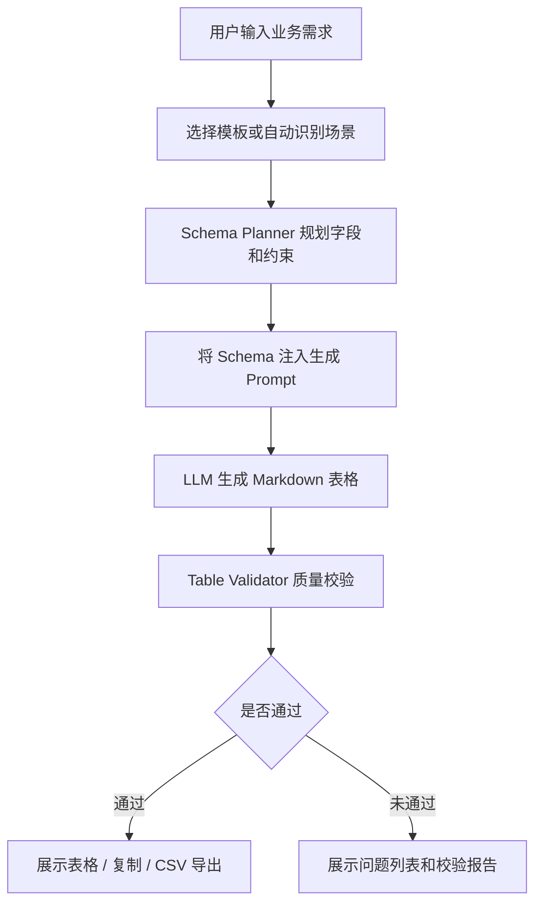
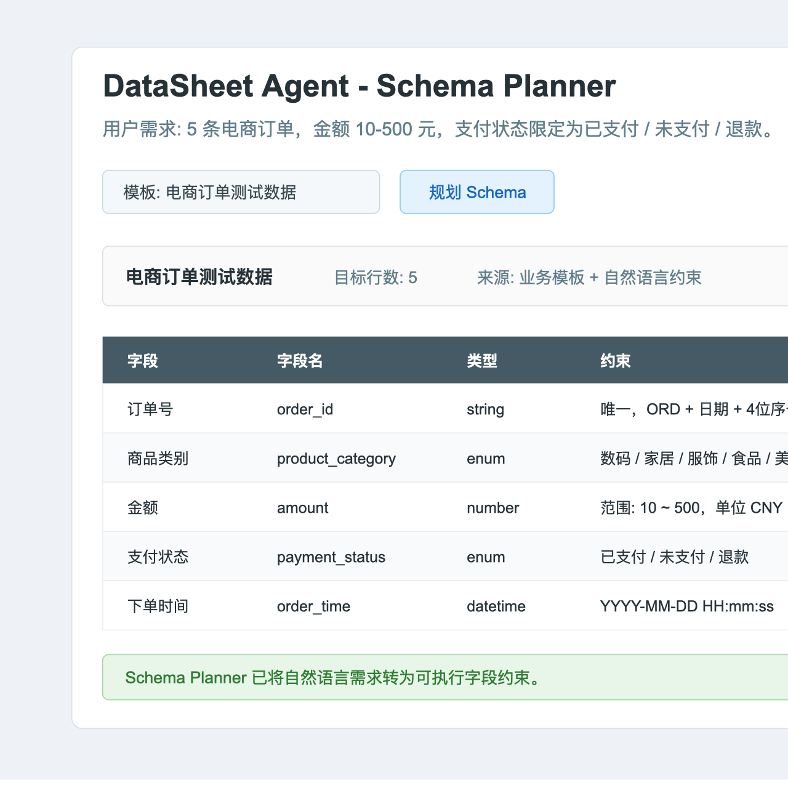
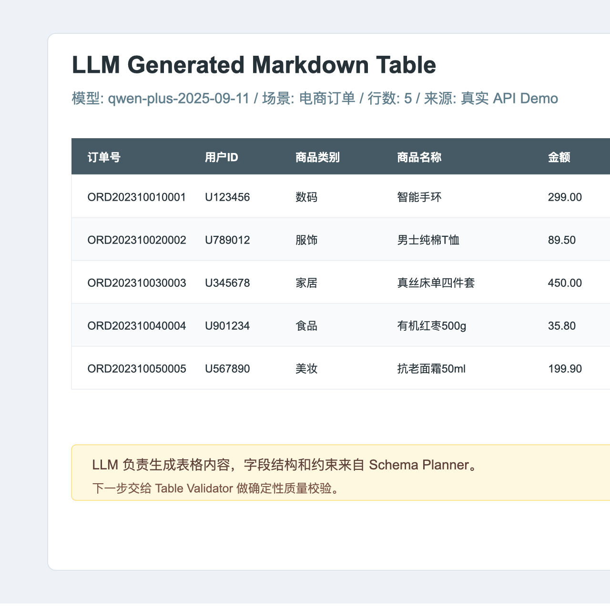
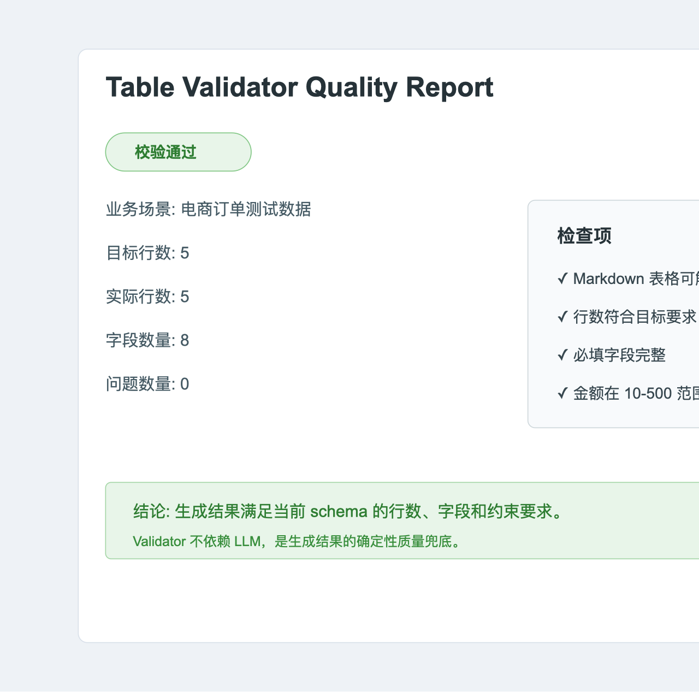
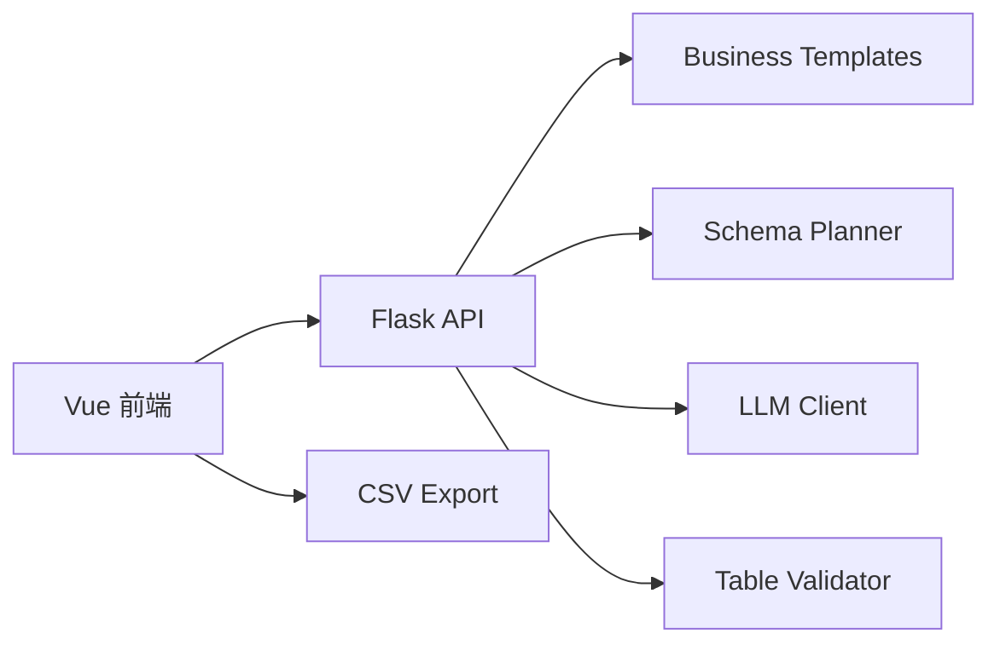

# DataSheet Agent

面向业务场景的智能表格生成与质量校验系统。

DataSheet Agent 是一个基于 Vue + Flask + OpenAI-compatible LLM API 的表格生成 Agent。项目由本科毕设中的“大模型 API 生成表格”能力升级而来，加入了业务模板、Schema Planner 和 Table Validator，让系统从“直接生成一张表”升级为“理解业务需求、规划字段结构、约束 LLM 生成、检查数据质量并导出”的轻量 Agent 闭环。

## 项目意义

很多测试、教学、产品 Demo 和数据看板原型都需要模拟业务数据，例如电商订单、学生信息、CRM 销售线索、招聘候选人等。真实业务数据通常涉及隐私和权限，不能随便用于调试；手工构造数据又耗时，并且容易遗漏字段约束。

DataSheet Agent 聚焦这个问题: 用自然语言快速构造接近业务语义的模拟表格数据，并通过 schema 和 validator 提高 LLM 输出的可控性。

## 核心能力

- 业务模板: 内置电商订单、学生信息、CRM 销售线索、招聘候选人 4 类模板。
- Schema Planner: 从自然语言中解析行数、字段、字段类型、枚举值、数值范围和必填项。
- LLM 生成: 将 schema 注入 prompt，约束模型生成 Markdown 表格。
- Table Validator: 对生成表格做确定性校验，检查行数、必填字段、枚举值和数值范围。
- 导出能力: 支持复制 Markdown 表格和导出 CSV。
- 模型配置: 默认使用 Qwen/DashScope OpenAI-compatible API，API Key 通过环境变量管理。

## Agent 工作流



## Demo 示例

推荐演示输入:

```text
生成 5 条电商订单测试数据，金额 10-500 元，支付状态包括已支付、未支付、退款。
```

推荐演示流程:

1. 选择 `电商订单测试数据` 模板。
2. 点击 `规划 Schema`，查看字段、类型和约束。
3. 点击 `生成表格`，由 LLM 生成 Markdown 表格。
4. 点击 `质量检查`，查看行数、字段、枚举值和金额范围是否通过校验。
5. 点击 `导出csv`，导出生成结果。

更完整的 Demo 脚本见 [docs/demo-guide.md](docs/demo-guide.md)。
真实 API Demo 记录见 [docs/demo-run.md](docs/demo-run.md)。

### Demo 截图

Schema Planner 将自然语言需求转换为字段、类型和约束:



LLM 按 schema 约束生成电商订单 Markdown 表格:



Table Validator 对生成结果做确定性质量校验:



## 技术架构



主要模块:

- `api/llm_client.py`: OpenAI-compatible LLM 调用层。
- `api/business_templates.py`: 内置业务模板。
- `api/schema_planner.py`: Schema 规划与自然语言约束解析。
- `api/table_validator.py`: Markdown 表格质量校验。
- `api/api.py`: Flask REST API。
- `frontend/src/App.vue`: 前端交互、Schema 展示、质量检查和 CSV 导出。

## 快速开始

### 后端

```bash
python3 -m venv .venv
source .venv/bin/activate
pip install -r requirements.txt
python api/api.py
```

默认后端地址:

```text
http://127.0.0.1:5000
```

### 前端

```bash
cd frontend
npm install
npm run serve
```

默认前端地址:

```text
http://127.0.0.1:8080/
```

## 环境变量

复制 `.env.example` 为 `.env`，填入 DashScope API Key:

```bash
cp .env.example .env
```

```env
LLM_PROVIDER=qwen
MODEL=qwen-plus-2025-09-11
DASHSCOPE_API_KEY=your_api_key_here
DASHSCOPE_BASE_URL=https://dashscope.aliyuncs.com/compatible-mode/v1
```

如果没有配置 API Key，真实 LLM 生成会不可用；Schema 规划和 Table Validator 仍可用于本地演示和测试。

## API 示例

获取业务模板:

```bash
curl http://127.0.0.1:5000/api/templates
```

规划 schema:

```bash
curl -X POST http://127.0.0.1:5000/api/schema/plan \
  -H "Content-Type: application/json" \
  -d '{"message":"生成 20 条招聘候选人信息表，期望薪资 8000-15000 元","template_id":"recruiting_candidates"}'
```

校验生成表格:

```bash
curl -X POST http://127.0.0.1:5000/api/validate \
  -H "Content-Type: application/json" \
  -d '{"markdown":"| 姓名 | 面试状态 |\n| --- | --- |\n| 王同学 | 一面中 |","schema_plan":{"scenario":"demo","scenario_label":"Demo","row_count":1,"schema":[{"name":"candidate_name","label":"姓名","type":"string","required":true,"constraints":{}},{"name":"interview_status","label":"面试状态","type":"enum","required":true,"constraints":{"enum":["待筛选","一面中","二面中","已通过","已淘汰"]}}]}}'
```

## 验证

后端单元测试:

```bash
PYTHONPYCACHEPREFIX=/tmp/datasheet-agent-pycache .venv/bin/python -m unittest discover -s tests -v
```

前端构建:

```bash
cd frontend
npm run build
```

## 项目包装

- Demo 演示指南: [docs/demo-guide.md](docs/demo-guide.md)
- 真实 Demo 运行记录: [docs/demo-run.md](docs/demo-run.md)
- 简历与面试包装: [docs/resume-interview-packaging.md](docs/resume-interview-packaging.md)

## 当前边界

- 当前主要支持标准 Markdown 表格解析。
- Schema Planner 使用业务模板和规则解析，不是复杂语义解析器。
- Table Validator 做确定性检查，不保证 LLM 输出一定正确。
- 当前未接入真实企业数据，定位是模拟业务数据生成。
- 当前不是复杂多 Agent 系统，而是轻量 Agent 工作流。

## 后续规划

- 自动修正: 校验失败后，将问题列表反馈给 LLM 进行定向修复。
- 导出增强: 支持 Excel、JSON 和 schema 配置导出。
- 模板复用: 支持用户保存自定义业务模板。
- 前端优化: 优化布局、增加 Demo 截图和更清晰的状态展示。
